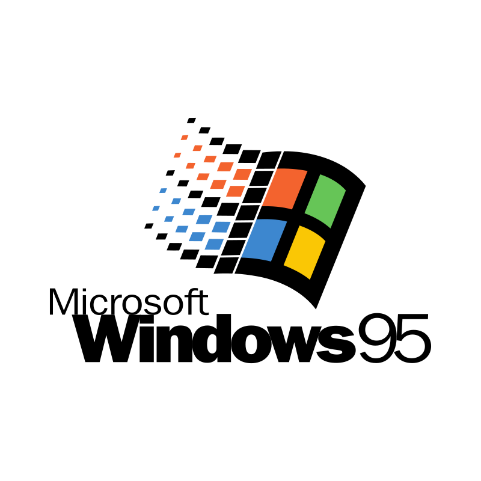

<br>
<br>
<br>
<p align="center">
  
</p>
<h1 align="center">Win95 - recreated</h1>
<h3 align="center">Click Start. Open a window. Lose an afternoon.</h3>

<p align="center">A faithful, lightweight Windows 95 desktop recreated in the browser — pure JavaScript, no framework, no backend, and no runtime dependencies.</p>
<p align="center">Made with ❤️ by <a href="https://github.com/lingyicute">lingyicute</a>.</p>
<br>
<br>
<p align="center">
  🇺🇸 English •
  <a href="https://95.92li.uk">🖥️ Live Demo</a> •
  <a href="https://github.com/lingyicute/Win95">🌐 Source Code</a> •
  <a href="https://github.com/lingyicute/Win95/issues">🐛 Report Bug</a>
</p>

<p align="center">
  <a href="./LICENSE"></a>
  <a href="./package.json"></a>
  <a href="https://github.com/lingyicute/Win95"></a>
  <a href="https://github.com/lingyicute/Win95"></a>
  <a href="https://github.com/lingyicute/Win95"></a>
</p>
<br>

## 📖 Overview

A teal desktop, a gray taskbar, and a Start button that still feels right. **Win95** brings the familiar 1995 desktop to your browser: open Explorer, draw in Paint, write in WordPad, play Minesweeper, drop to an MS-DOS prompt, and tweak settings in the Control Panel.

It is built with **plain ES modules, HTML, and CSS** — no framework, no bundler, and no `node_modules` needed to run it. Your files live in a virtual `C:` drive stored in your own browser, so there is nothing to install, no account to create, and no server holding your data.

<br>

## ✨ Features

- **🖥️ A Desktop That Behaves Like One**
  - Boot screen with the startup chime, desktop icons, draggable and resizable windows, a taskbar with running programs, a Start menu with Programs, Documents, Settings, Find, Help, Run, and Shut Down, plus a system tray with volume and clock.
  - Right-click menus, Cascade / Tile / Minimize All, Taskbar Properties, Close Program (Task Manager-style), and a Log Off / Shut Down / Restart flow.

- **🗂️ Programs and Accessories**
  - **Files:** Windows Explorer, My Computer, My Documents, Recycle Bin, My Briefcase, Find Files or Folders.
  - **Create:** Notepad, WordPad (RTF), Paint, Calculator, Character Map, Clipboard Viewer, Address Book.
  - **Media & Web:** Media Player, CD Player, Sound Recorder, Volume Control, Internet Explorer.
  - **Communications:** Microsoft Exchange (Inbox).
  - **System Tools:** System Monitor, Microsoft Backup, Disk Defragmenter, ScanDisk, Registry Editor.

- **🃏 Classic Games**
  - **Minesweeper** with Beginner, Intermediate, Expert, and Custom boards and best times.
  - **Solitaire** with Draw One and Draw Three.
  - **FreeCell** and **Hearts**, each backed by its own game engine.

- **⌨️ A Working MS-DOS Prompt**
  - Built-in commands include `DIR`, `CD`, `MD`, `RD`, `COPY`, `MOVE`, `DEL`, `REN`, `TYPE`, `TREE`, `ATTRIB`, `FIND`, `SORT`, `SET`, `PATH`, `PROMPT`, `ECHO`, `CALL`, `GOTO`, and more.
  - Operates on the same virtual drive as Explorer, and can launch apps such as Notepad, WordPad, and Paint.

- **🎛️ Control Panel**
  - Display (background, appearance, screen savers — **Marquee**, **Mystify**, **Starfield**), Sounds, Keyboard, Mouse (pointer trails), Date/Time, Regional Settings, Fonts, Printers, Network, System, Add/Remove Programs, Accessibility Options, Multimedia, Passwords, Modems, Joystick, Add New Hardware, and Power.
  - Cursor schemes and pointer trails for the full 90s feel.

- **🌏 English and Chinese UI**
  - The interface follows your browser language (Chinese browsers get 简体中文, everything else gets English). You can also pin a language in **Regional Settings**.
  - Bundled fonts (W95FA, Roboto, and a CJK font) keep text consistent across devices.

- **💾 Your Files, Kept Locally**
  - The virtual `C:` drive is saved in your browser with **IndexedDB**, falling back to `localStorage` when needed (and to in-memory if neither is available).
  - **Microsoft Backup** exports and restores your drive as a file; Explorer can import files from your computer (up to 16 MB each).
  - **Reset Windows** wipes the virtual drive and settings, with multiple confirmations.

- **🔒 Private by Design**
  - No backend, analytics, or tracking. Files and settings stay in your browser's storage.
  - The one exception is **Internet Explorer**: if you type in a web address, the page is loaded in a sandboxed frame (sites that forbid embedding can be opened in a new tab instead).

<br>

## 🎮 Getting Around

| Action | Control |
| --- | --- |
| Start playing | Click or tap **Tap to start** on the boot screen |
| Open the Start menu | Click **Start** |
| Open an icon | Double-click it (or use the right-click menu → **Open**) |
| Move / resize a window | Drag the title bar / drag the window edges |
| Switch programs | Click a button on the taskbar |
| Arrange windows | Right-click the taskbar → **Cascade**, **Tile**, or **Minimize All Windows** |
| Run a program by name | **Start → Run…** (e.g. `notepad`, `mspaint`, `calc`, `sol`, `winmine`, `freecell`, `regedit`, `command`) |
| Get a DOS prompt | **Start → Programs → MS-DOS Prompt** |
| Back up your files | **Start → Programs → Accessories → System Tools → Backup** |
| Shut down | **Start → Shut Down…** |

<br>

## 🛠️ Why Win95? (Under the Hood)

### 1. Pure Web Platform, No Framework

The whole desktop is written as ES modules, HTML, and CSS, wired together with a native **import map** (`@win95/core/`, `@win95/ui/`, `@win95/graphics/`, `@win95/shell/`). There is no bundler, transpiler, or UI library between the source and the browser.

### 2. A Modular Codebase

`src/packages/` is split by responsibility:

| Package | What lives there |
| --- | --- |
| `core` | Virtual file system, DOS engine, RTF support, i18n |
| `ui` | Dialogs, menus, select boxes, trackbars, icons, DOM helpers |
| `graphics` | The desktop renderer |
| `shell` | Window manager, cursors, pointer trails, desktop reveal |
| `apps` | Explorer, Paint, documents, multimedia, utilities, Control Panel, DOS prompt |
| `games` | Minesweeper, Solitaire, FreeCell, and Hearts (UI and engines) |

### 3. Your Data Stays on Your Device

Files, settings, and the registry are stored locally in your browser. Nothing is uploaded, and exporting a backup is always up to you.

### 4. Cache-Safe Deployments

A small build step copies `src/` into `_site/` and appends `?v=<version>` to every stylesheet, script, module import, font, and audio reference. Each deployment therefore changes every asset URL, so returning visitors get the new release instead of a stale cached one — while the long cache lifetime still keeps repeat visits fast. Local development serves `src/` directly and skips this step.

<br>

## 🚀 Play It Now

### Option 1 — Open the live demo

Visit **[95.92li.uk](https://95.92li.uk)** in a modern browser.

### Option 2 — Run it locally

```bash
git clone https://github.com/lingyicute/Win95.git
cd Win95
npm run serve
```

Then open [http://localhost:8080](http://localhost:8080). `npm run serve` simply runs `python3 -m http.server 8080 --directory src`, so any static file server pointed at `src/` works too.

> [!tip]
> The game uses ES modules and an import map, so it must be served over HTTP — opening `src/index.html` directly from disk (`file://`) will not work.

### Option 3 — Publish it anywhere

Build the deployable site and upload `_site/` to any static host:

```bash
npm run build
```

- **GitHub Pages:** the included workflow (`.github/workflows/pages.yml`) builds with the commit SHA and deploys on every push to `main`.
- **Cloudflare Pages:** use `npm run build` as the build command and `_site` as the output directory. The build picks up `CF_PAGES_COMMIT_SHA` automatically.
- **Anywhere else:** set `APP_VERSION` (or pass `--version`) to control the cache-busting token.

The generated `_site/` directory is intentionally ignored by Git: each hosting platform builds it from the committed source instead of checking build output back into the repository.

### Requirements

- **Browser:** a modern browser with ES module, import map, and Web Audio support (Chrome, Edge, Firefox, Safari, or a mobile equivalent).
- **Network:** only needed to download the site (and for Internet Explorer pages). The desktop itself makes no API calls.
- **Storage:** IndexedDB or `localStorage` keeps your virtual drive and settings; without storage the desktop still works, but nothing is saved after you close the tab.
- **Permissions:** none.

<br>

## 🔨 Building and Testing

The repository has no runtime dependencies, so there is no `npm install` step.

| Command | What it does |
| --- | --- |
| `npm run serve` | Serves `src/` at `http://localhost:8080` for development |
| `npm run build` | Generates the versioned site in `_site/` |
| `npm test` | Runs the test suite with Node's built-in test runner |

To build with a specific version token:

```bash
node tools/build-site.mjs --source src --output _site --version my-release
```

### Running the tests

```bash
npm test
```

The suite (`tests/*.test.mjs`) uses Node's native `node --test` runner and a small DOM shim — no browser needed. It covers the virtual file system, DOS engine, i18n and regional settings, RTF, Minesweeper, FreeCell, Hearts, Klondike, window frames, menus, trackbars, cursors, desktop reveal, the screen-saver wait time, and the site build step.

Testing requires **Node.js 20 or newer** (see `.nvmrc`). Node and Python 3 are **development tools only**; they are not needed to use the deployed site.

<br>

## 🤗 Contributing

Contributions are welcome!

- **Bug Reports & Feature Requests:** open an issue in the [GitHub Issue Tracker](https://github.com/lingyicute/Win95/issues).
- **Pull Requests:** please keep the project framework-free and dependency-free, and keep the desktop quick to boot.
- **Before submitting:** run `npm test`, and `npm run build` if you touched asset paths or imports.

<br>

## 📄 License

This project is licensed under the **GNU Affero General Public License v3.0 (AGPL-3.0)**. See [LICENSE](./LICENSE) for the full text.

*Windows 95 is a trademark of Microsoft Corporation. This is an independent, non-commercial tribute and is not affiliated with or endorsed by Microsoft.*
